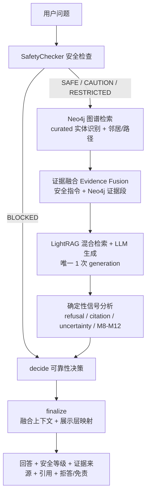
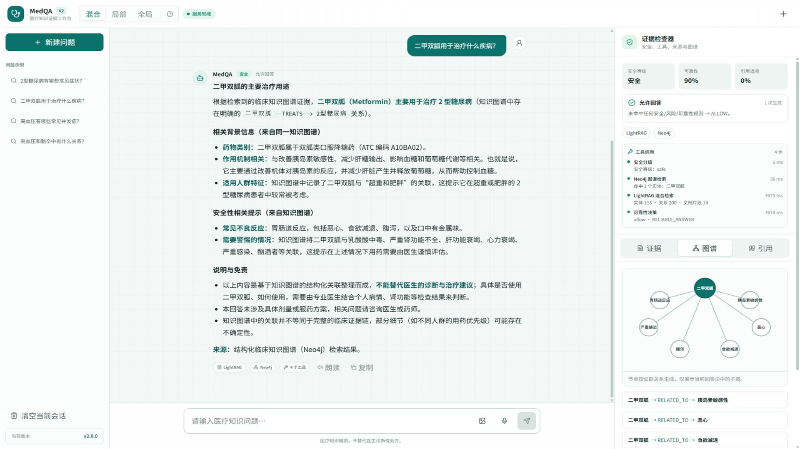
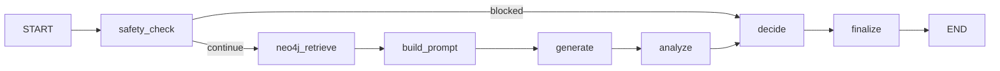
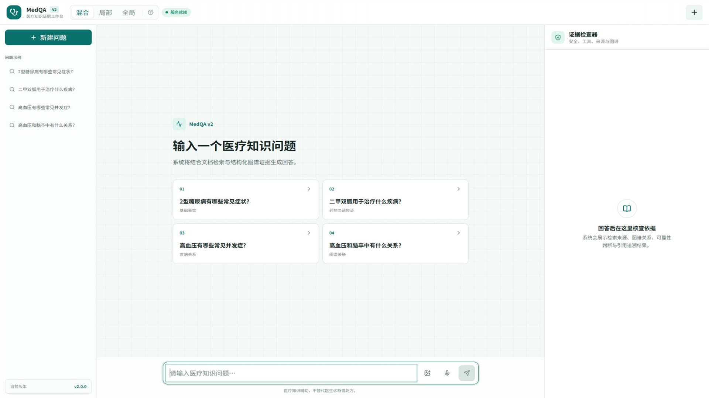

<div align="center">

# 🩺 MedQA — 医疗知识图谱 + RAG 智能问答系统

**Medical Knowledge Graph + Retrieval-Augmented Generation QA System**

面向医疗知识问答场景，将 **Knowledge Graph** 与 **RAG** 融合，内置安全控制、证据融合与来源引用机制的智能问答系统。

       

[](https://github.com/constantine070711/MedQA-KG-RAG/actions/workflows/v2-ci.yml)

</div>

---

## 目录

- [1. 项目简介](#1-项目简介)
- [2. 项目背景](#2-项目背景)
- [3. 核心功能](#3-核心功能)
- [4. 技术栈](#4-技术栈)
- [5. 系统架构](#5-系统架构)
- [6. RAG + Knowledge Graph 工作流程](#6-rag--knowledge-graph-工作流程)
- [7. Agent Workflow](#7-agent-workflow)
- [8. 医疗安全机制](#8-医疗安全机制)
- [9. Evidence / Citation（证据与引用）](#9-evidence--citation证据与引用)
- [10. Memory 多轮对话](#10-memory-多轮对话)
- [11. 可观测性（Monitoring）](#11-可观测性monitoring)
- [12. 项目结构](#12-项目结构)
- [13. 环境要求](#13-环境要求)
- [14. 安装](#14-安装)
- [15. 配置](#15-配置)
- [16. 启动](#16-启动)
- [17. Demo 示例问题](#17-demo-示例问题)
- [18. Evaluation / 实验结果](#18-evaluation--实验结果)
- [19. 项目亮点](#19-项目亮点)
- [20. 当前限制](#20-当前限制)
- [21. 后续规划（Future Work）](#21-后续规划future-work)
- [22. License](#22-license)
- [23. Disclaimer（免责声明）](#23-disclaimer免责声明)

---

## 1. 项目简介

**MedQA** 是一个面向中文医疗知识问答场景的 **知识图谱（Knowledge Graph）+ 检索增强生成（RAG）** 智能问答系统。

它解决的问题是：**通用 RAG 只做「向量检索 → LLM 生成」**，回答容易缺乏结构化事实依据、难以溯源、且缺乏面向医疗场景的安全边界。MedQA 在此基础上：

- 引入 **Neo4j 结构化医疗知识图谱**（实体、关系、三元组），提供可解释的结构化证据；
- 设计 **Evidence Fusion 证据融合层**，统一 LightRAG 图/向量证据与 Neo4j 图谱证据；
- 构建 **LangGraph Agent 工作流**，将「安全检测 → 检索 → 生成 → 信号分析 → 可靠性决策」编排为确定性流程；
- 内置 **SafetyChecker 医疗安全分级机制**，对诊断、用药剂量、心理危机等高危问题分级处理；
- 输出 **来源引用与可靠性判定**，让回答可追溯、可解释。

> ⚠️ 本项目定位为 **医疗知识辅助** 的工程系统与科研实验基础，**不替代医生诊断**。仅供学习、研究与演示使用。

### 版本选择

| 版本 | 分支 | 技术栈 | 说明 |
|---|---|---|---|
| **v2（当前版本）** | [v2](https://github.com/constantine070711/MedQA-KG-RAG/tree/v2) | Next.js + TypeScript + FastAPI SSE | 证据工作台、工具轨迹、语音和图片 OCR |
| **v1（历史版本）** | [v1](https://github.com/constantine070711/MedQA-KG-RAG/tree/v1) | Python + Streamlit | 原始知识图谱与 RAG 问答界面 |

`v1.0.0` 标签保留 v1 的不可变归档；`main` 与 `v2` 当前保持同步，打开仓库默认查看 v2 内容。也可以通过 GitHub 页面左上角的分支选择器切换代码版本。

### 项目文档

- [公开文档索引](docs/README.md)
- [真实开发时间线](docs/development-history.md)

---

## 2. 项目背景

医疗问答与通用问答不同，具有三个突出难点：

1. **专业性**：回答必须基于可靠的医学知识，不能凭空编造；
2. **安全性**：涉及诊断、用药剂量、心理危机等问题时，必须分级处理甚至拒答；
3. **可追溯性**：回答应能回溯到具体知识来源，方便用户与医生核查。

本项目从「知识图谱 + RAG 融合」出发，逐步构建了一套完整的医疗问答系统：

- **Phase 1-4**：LightRAG 混合检索底座 + 数据管道（Adapter → Transformer → Writer）+ 元数据追溯；
- **Phase 5**：医学指标（M1/M2/MRR）、引用验证（Citation Verifier）、不确定性信号（Uncertainty Signals）、可靠性决策（Reliability Decision）；
- **Phase 6**：Neo4j 医疗知识图谱 + 图谱检索器（Graph Retriever）+ 证据融合（Evidence Fusion）；
- **Phase 7**：LangGraph Agent 工作流编排；
- **Phase 8**：Streamlit Web UI + 知识图谱可视化；
- **Phase 9**：多轮对话 Memory；
- **Phase 10**：结构化医学知识库扩展实验（独立 Experiment KB，与生产环境隔离）、Reranker 实验评估、日志与监控旁路。
- **v2 应用版本**：Next.js 证据工作台、FastAPI SSE、MCP 工具、语音输入/朗读、本地图片 OCR 和 GitHub Actions。

---

## 3. 核心功能

| 功能 | 说明 |
|------|------|
| 🔍 **混合检索** | LightRAG 图 + 向量混合检索（`naive / local / global / hybrid / mix` 五种模式） |
| 🕸️ **知识图谱检索** | Neo4j 结构化检索：实体、邻居、路径、相关关系（Cypher 参数化 + 白名单校验） |
| 🧬 **证据融合** | 融合 LightRAG 与 Neo4j 证据，跨来源去重、保留 provenance、优先级排序截断 |
| 🛡️ **安全控制** | SafetyChecker 四级分类（SAFE / CAUTION / RESTRICTED / BLOCKED）+ 拒答策略 |
| ✅ **可靠性决策** | M8-M12 指标 + ReliabilityDecision，输出 allow / revise / refuse |
| 📚 **来源引用** | Citation Extractor / Verifier，计算引用可追溯比例（grounded ratio） |
| 💬 **多轮对话** | 有限窗口 Memory（最近 3 轮 / 600 字符），仅作生成背景，不污染证据 |
| 📊 **可观测性** | request_id + JSONL 结构化日志 + 敏感信息脱敏 + 日志轮转 |
| 🖥️ **Web UI** | v2：Next.js 证据工作台 + SSE 流式回答；v1：Streamlit + pyvis |
| 🧪 **评测体系** | 完整评测框架：28 题固定评测集 + `tests/` 495 项 + `evaluation/` 97 项；Neo4j 未启动时 24 项集成测试跳过 |
| 🧰 **MCP / 工具调用** | LightRAG、Neo4j 实体/关系/路径查询封装为受控工具；stdio MCP Server + HTTP 工具网关 + 前端调用轨迹 |
| 🔊 **语音多模态** | 浏览器中文语音输入 + 回答朗读；不支持 Web Speech API 时自动保留文本工作流 |
| 🖼️ **图片文字识别** | 药盒/说明书/化验单图片在浏览器本地 OCR；识别文字可编辑，命中实体后可发起通用知识问题 |

---

## 4. 技术栈

| 层 | 技术 |
|----|------|
| 语言 / 环境 | Python 3.11 |
| RAG 引擎 | **LightRAG 1.5.4**（图 + 向量混合，增量索引） |
| 图数据库 | **Neo4j**（Community 5.x，Docker Compose 一键启动） |
| Agent 工作流 | **LangGraph**（StateGraph，7 节点确定性编排） |
| LLM | **DeepSeek API**（OpenAI 兼容接口） |
| Embedding | **bge-small-zh-v1.5**（默认，512 维，本地加载）· bge-m3（本地可用，可切换） |
| Reranker | bge-reranker-base（实验评估阶段） |
| Web UI | **Next.js 16 + TypeScript**（v2）· Streamlit + pyvis（v1） |
| API | **FastAPI + Server-Sent Events** |
| Agent Tools | **MCP stdio server + HTTP tool gateway** |
| Multimodal | **Web Speech API**（语音输入 / 朗读） |
| Image OCR | **Tesseract.js**（`chi_sim+eng`，浏览器本地运行） |
| 评测 | `evaluation/` 自研指标 + `unittest` 回归测试 |
| 部署 | Docker Compose（当前仅 Neo4j；v2 三服务一键部署待补充） |

---

## 5. 系统架构（v2）

```
┌──────────────────────────────────────────────────────────────────────────┐
│                  Evidence Workspace (Next.js 16 / TS)                    │
│      对话 · 流式回答 · 安全/可靠性 · 证据检查器 · 工具轨迹 · 语音/OCR      │
└──────────────────────────────────┬───────────────────────────────────────┘
                                   │ SSE
┌──────────────────────────────────▼───────────────────────────────────────┐
│                         FastAPI v2 Gateway                               │
│             /api/chat/stream · /api/tools · tools/execute                │
└──────────────────────────────────┬───────────────────────────────────────┘
                                   │
┌──────────────────────────────────▼───────────────────────────────────────┐
│                    MedQAAgent (LangGraph StateGraph)                     │
│ safety_check → neo4j_retrieve → build_prompt → generate → analyze        │
│              → decide → finalize（BLOCKED 直接进入 decide）               │
└──────────────┬───────────────────┬───────────────────┬──────────────────┘
               │                   │                   │
       ┌───────▼────────┐  ┌───────▼────────┐  ┌───────▼────────┐
       │ LightRAG       │  │ Neo4j          │  │ MCP / Toolbox  │
       │ 向量 + 图检索   │  │ 结构化三元组    │  │ 只读检索工具    │
       └───────┬────────┘  └───────┬────────┘  └───────┬────────┘
               └───────────────────┼───────────────────┘
                         ┌─────────▼─────────┐
                         │ Evidence Fusion   │
                         │ Reliability Gate  │
                         └───────────────────┘
```

> 本文件后续章节继续描述从 v1 继承的检索、证据融合、安全与评测核心；v2 只替换展示层并增加工具、语音和图片输入，不重写医疗检索核心。

---

## 6. RAG + Knowledge Graph 工作流程

MedQA 不是简单的 `retrieve → LLM`，而是一条完整的多源证据链路：



**为什么需要证据融合？**

双路检索会返回「格式异构、来源不同、可能重复」的候选证据。Evidence Fusion 负责：

1. **跨来源合并**：LightRAG 实体与 Neo4j 节点按 canonical 名称合并，保留全部 provenance；
2. **优先级排序**：`Neo4j 三元组 > Neo4j 节点 > LightRAG 关系 > LightRAG 实体 > 向量块`；
3. **有界截断**：先排序后截断，防止超长 prompt；
4. **诚实覆盖**：无证据时如实记录 coverage notes，绝不伪造实体或关系。

最终，**仅结构化的 Neo4j 证据段 + 安全指令被注入 system_prompt**，向量块等由 LightRAG 检索进上下文，LLM 在「证据受限」的约束下生成回答。

**知识图谱可视化**：v2 证据检查器会根据当前回答命中的结构化证据生成实体关系图，并可在“证据 / 图谱 / 引用”之间切换。v1 的 pyvis / vis.js 可视化仍保留在历史分支中：

<p align="center">
  
</p>

---

## 7. Agent Workflow

系统使用 **LangGraph StateGraph** 将问答编排为 7 个节点 + 1 条条件边的确定性工作流（`src/agent.py`）：



| 节点 | 职责 |
|------|------|
| `safety_check` | SafetyChecker 分级；BLOCKED 直接路由到决策，**不触发检索与 LLM** |
| `neo4j_retrieve` | 确定性识别 curated 实体（零 LLM）→ Neo4j 图谱检索 |
| `build_prompt` | 安全指令 + Neo4j 证据段 + （可选）多轮 Memory 背景 |
| `generate` | LightRAG 混合检索 + **唯一 1 次** LLM 生成 |
| `analyze` | 确定性信号链：拒答检测 / 引用分析 / 不确定性信号 / M8-M12 指标（零 LLM） |
| `decide` | ReliabilityDecision 终端门：allow / revise / refuse |
| `finalize` | fuse_evidence 融合 + 展示层映射（回答 / 安全等级 / 引用 / 覆盖） |

**Agent 的关键约束**（对齐代码实际行为）：

- 非 BLOCKED 路径 **恰好 1 次** LLM generation；
- BLOCKED 路径 **0 次** LLM generation、**0 次** 图谱检索；
- 信号分析与可靠性决策均为确定性规则，**不消耗 LLM API**；
- 动态 system_prompt 时临时禁用 LightRAG generation 缓存，避免缓存命中旧回答。

---

## 8. 医疗安全机制

系统面向医疗问答场景设计了**分级安全控制机制**（`src/medical_core/safety.py`）：

| 级别 | 触发示例 | 行为 |
|------|---------|------|
| 🟢 **SAFE** | 概念解释、健康知识 | 正常回答 |
| 🟡 **CAUTION** | 症状咨询、一般药物咨询 | 正常回答 + 附加医疗免责声明 |
| 🟠 **RESTRICTED** | 个人诊断、用药剂量 | 仅提供通用医学知识，强调就医，**不提供具体诊断/用药方案** |
| 🔴 **BLOCKED** | 自杀/自残/心理危机 | 拒答 + 心理危机干预热线 |

除此之外：

- **诊断意图拒答**：识别「我是不是得了…」「帮我诊断」等个人诊疗问题 → 拒答并建议就医；
- **剂量请求拒答**：「吃几片」「用量」等 → 拒绝提供具体剂量；
- **不确定性拒答**：知识库覆盖不足或可靠性不足时明确拒答，**不编造**；
- **紧急情况识别**：胸痛、呼吸困难等 → 提示立即拨打 120；
- **每轮 LLM 生成次数受控**：BLOCKED 为 0 次，常规为 1 次。

> ⚠️ 设计定位是**面向医疗问答场景的安全控制机制**，属于工程约束与风险缓解手段，**不能等同于临床安全保证**。

---

## 9. Evidence / Citation（证据与引用）

**证据（Evidence）**：每次回答都会输出结构化的 `fused_context`，包含证据来源统计（`lightrag_vector / lightrag_graph / neo4j_graph`）、证据条目（含 provenance）、覆盖说明。

**引用（Citation）**：回答生成后，`Citation Extractor / Verifier`（`evaluation/`）会：

1. 从回答中提取潜在引用（实体名 / 句子片段）；
2. 与检索到的实体 / 文本块比对；
3. 输出 **引用可追溯比例（grounded ratio）** 与逐条追溯结果。

结合 **不确定性信号**（`Uncertainty Signals`，B4）与 **可靠性决策**（`ReliabilityDecision`，5C），系统最终输出 `allow / revise / refuse` 三个档位之一，避免「低置信度却给出确定回答」的情况。

---

## 10. Memory 多轮对话

系统支持多轮对话上下文（Phase 9），采用 **有限窗口机制**：

- 保留最近 **3 轮** 合格对话、总长不超过 **600 字符**；
- Memory 仅作为 **LLM generation 的对话背景**（`conversation_context`）追加到 system_prompt；
- **不进入** 证据、引用、检索与可靠性决策——历史信息不会伪装成当前轮的医学证据；
- 多轮代码基于「用户问题 + 助手回答」构建，指代（如「那它呢」）可在上下文中消解。

> 当前实现为**有限窗口**的多轮上下文机制，可根据后续需求扩展上下文窗口（如更长窗口、向量记忆、摘要记忆）。

---

## 11. 可观测性（Monitoring）

系统内置轻量可观测性层（`src/monitoring.py`，Phase 10-C）：

- **request_id**：每次调用生成唯一请求 ID；
- **结构化日志**：JSON Lines 输出到 `data/logs/medqa.jsonl`（已 gitignore）；
- **指标白名单**：safety_level、neo4j_status、generation_count、decision、reason_code、m12、grounded_ratio 等；
- **敏感信息脱敏**：question 仅记录 sha256 hash，API key / token / password / traceback **一律不入日志**；
- **日志轮转**：单文件超 5MB 滚动，保留最近 3 份备份；
- **失败静默降级**：日志任何异常都不影响问答主流程。

---

## 12. 项目结构

```
MedQA-GitHub/
├── api/                     # v2 FastAPI + SSE 网关
│   ├── main.py              # /api/health, /api/chat/stream
│   ├── runtime.py           # LangGraph 节点事件 → SSE
│   └── schemas.py           # 请求模型与历史窗口
├── mcp_server/              # MCP stdio 服务
│   └── medqa_mcp.py         # 5 个只读医疗知识工具
├── web/                     # v2 Next.js + TypeScript 证据工作台
│   └── src/
│       ├── app/             # App Router 页面与样式
│       ├── components/      # 工作台 / 证据检查器 / 图谱视图
│       └── lib/             # SSE 客户端、类型与展示纯函数
├── app/                     # v1 Streamlit Web UI（保留）
│   ├── streamlit_app.py     # 对话式问答入口（streamlit run app/streamlit_app.py）
│   └── ui_helpers.py        # 展示逻辑 / Memory 构建 / Agent 调用
├── src/                     # 核心生产代码
│   ├── agent.py             # LangGraph Agent（7 节点工作流）
│   ├── rag_engine.py        # LightRAG 混合检索引擎（5 种模式）
│   ├── evidence_fusion.py   # 证据融合层（纯函数，零 LLM / 零 DB）
│   ├── neo4j_graph.py       # Neo4j 结构化图谱检索（只读，白名单校验）
│   ├── neo4j_utils.py       # Neo4j 连接管理与 Schema
│   ├── medical_core/        # 医疗领域核心：entities / relations / safety
│   ├── monitoring.py        # 可观测性：request_id + JSONL 日志 + 脱敏
│   ├── retrieval/           # Reranker（实验评估阶段）
│   ├── pipeline/            # 数据管道：Adapter → Transformer → Writer
│   ├── data_adapter/        # CBLUE / 医学知识库数据适配器
│   ├── embedder.py          # bge 系列本地 Embedding
│   └── llm_client.py        # DeepSeek LLM 客户端
├── evaluation/              # 评测框架
│   ├── metrics.py           # M1/M2/MRR + M8-M12 指标
│   ├── reliability_decision.py # 可靠性决策（allow/revise/refuse）
│   ├── citation_verifier.py # 引用验证
│   ├── uncertainty_signals.py # 不确定性信号
│   └── runner.py            # 评测运行器
├── scripts/                 # 运行 / 索引 / 评测 / 导入脚本
│   ├── run_graph_query.py   # 命令行图谱融合问答
│   ├── run_query.py         # 命令行 RAG 问答
│   ├── index_docs.py        # 文档索引 → LightRAG
│   ├── run_pipeline.py      # 数据管道执行
│   ├── neo4j_bootstrap.py   # Neo4j Schema 初始化
│   ├── import_graphml_to_neo4j.py   # LightRAG 原始层导入
│   └── import_curated_to_neo4j.py   # curated 临床层导入
├── tests/                   # 单元测试（python -m unittest）
├── data/                    # 数据
│   ├── raw/diseases/        # 示例疾病知识库（9 个 .md，公开可传）
│   ├── raw/drugs/           # 示例药物知识库（5 个 .md，公开可传）
│   ├── entities/            # curated 实体与关系（Neo4j 临床层）
│   ├── external/            # 真实医学数据集（CMeIE，gitignore，仅保留 SOURCE.md）
│   └── SOURCES.md           # 数据来源与许可证记录
├── ARCHITECTURE.md          # 系统架构详细文档
├── models/                  # 本地模型权重（gitignore，自动下载）
├── lightrag_cache/          # LightRAG 索引缓存（gitignore，可重建）
├── .env.example             # 环境变量模板
├── docker-compose.yml       # Neo4j 一键启动
└── requirements.txt
```

---

## 13. 环境要求

- **Python 3.11**
- **Node.js 20+**（v2 前端）
- **DeepSeek API Key**（[platform.deepseek.com](https://platform.deepseek.com)）
- **Neo4j**（可选，可通过 `docker compose up -d neo4j` 一键启动；不启动时系统自动降级为纯 LightRAG 检索）
- 本机内存建议 ≥ 8GB（bge embedding + LightRAG 加载）

---

## 14. 安装

```bash
# 1. 克隆仓库
git clone https://github.com/constantine070711/MedQA-KG-RAG.git
cd MedQA-KG-RAG

# 2. 创建虚拟环境（Windows）
python -m venv venv
venv\Scripts\activate

# 3. 安装依赖
pip install -r requirements.txt

# 4. 配置环境变量
copy .env.example .env
#   编辑 .env，填入 DEEPSEEK_API_KEY（与可选的 NEO4J_PASSWORD）

# 5. 安装 v2 前端（新终端）
cd web
npm install
copy .env.example .env.local
```

> 如果 `sentence-transformers` 安装时网络受限，可先单独安装合适版本的 torch 再安装依赖。

---

## 15. 配置

`.env` 配置项（详见 `.env.example`）：

```env
# DeepSeek API
DEEPSEEK_API_KEY=your_deepseek_api_key_here
DEEPSEEK_BASE_URL=https://api.deepseek.com
DEEPSEEK_MODEL=deepseek-v4-flash

# Neo4j（可选）
NEO4J_URI=bolt://localhost:7687
NEO4J_USER=neo4j
NEO4J_PASSWORD=your_neo4j_password_here

# 应用
APP_HOST=127.0.0.1
APP_PORT=8501
APP_ORIGINS=http://localhost:3000,http://127.0.0.1:3000
LOG_LEVEL=INFO
```

**关于本地模型**：`models/` 目录下的 embedding / reranker 模型不入库（`.gitignore`）。首次运行时系统会：
- 若 `models/bge-small-zh-v1.5/` 存在则本地加载；
- 否则自动从 HuggingFace 下载 `BAAI/bge-small-zh-v1.5`。

**关于 Neo4j**（可选增强）：启动 Neo4j 后依次执行：

```bash
docker compose up -d neo4j           # 启动容器（.env 中的 NEO4J_USER/PASSWORD 生效）
python scripts/neo4j_bootstrap.py    # 初始化 Schema（约束 + 索引，幂等）
python scripts/index_docs.py         # 索引文档 → LightRAG（生成 graphml）
python scripts/import_graphml_to_neo4j.py  # 导入 LightRAG 原始层
python scripts/import_curated_to_neo4j.py  # 导入 curated 临床层
```

> 未配置 Neo4j 时系统也能运行：`neo4j_unavailable` 会在 UI 中如实展示，回答降级为 LightRAG 检索。

---

## 16. 启动

### Docker Compose（推荐）

```powershell
# 首次初始化 Neo4j + LightRAG 索引
docker compose --profile init run --rm neo4j-init

# 启动 API 和 Web
docker compose up -d --build api web

# 访问
# Web: http://localhost:3000
# API: http://localhost:8000/api/health
```

完整的环境变量、首轮索引、公网部署和故障排查见
[docs/deployment.md](docs/deployment.md)。

### 本地开发

```bash
# v2 API（终端 1）
uvicorn api.main:app --reload --port 8000

# v2 Web UI（终端 2）
cd web
npm run dev

# MCP Server（stdio，可选）
python -m mcp_server.medqa_mcp

# v1 Streamlit（仍可运行）
streamlit run app/streamlit_app.py

# 命令行问答（含图谱证据融合）
python scripts/run_graph_query.py --question "二甲双胍用于治疗什么疾病？"

# 命令行 RAG 问答
python scripts/run_query.py --question "糖尿病有哪些症状?" --safe
```

首次查询需加载检索内核（约 10-40 秒），后续查询会明显更快。

---

## 17. Demo 示例问题

```text
- 2型糖尿病的常见症状有哪些？
- 二甲双胍用于治疗什么疾病？
- 高血压有哪些常见并发症？
- 高血压和脑卒中有什么关系？
```

回答界面会同时展示：**安全等级、可靠性判断、证据来源（LightRAG / Neo4j 三元组）、来源引用、知识图谱可视化**。

<p align="center">
  
</p>


---

## 18. Evaluation / 实验结果

### 18.1 固定评测集（28 题，Phase 5 基准）

| 指标 | 基线（Baseline） | 说明 |
|------|:---:|------|
| **M1**（实体命中） | 0.9881 | 检索实体与标准答案实体的重合度 |
| **M2**（关系命中） | 0.8685 | 检索关系与标准答案关系的重合度 |
| **MRR**（证据排序） | 0.4900 | 证据排序质量（平均倒数排名） |

### 18.2 医学知识库扩展实验（Phase 10，独立 Experiment KB）

使用 **CMeIE 5,000 条** 结构化医学知识（0 LLM ingest，5,014 chunks / 10,371 entities / 13,390 relations）构建实验知识库（约 130 MB），与生产链路隔离验证：

| 指标 | 基线 | 实验（扩展 KB） |
|------|:---:|:---:|
| M1 | 0.9881 | 0.9881 |
| M2 | 0.8685 | 0.8357 |
| MRR | 0.4900 | 0.3207 |

**结论**：大规模扩展知识库在固定评测集上**未带来增益**（M2/MRR 略降），当前 5,000 条扩展 KB **不接入生产链路**，保留为独立 Experiment KB。该结论指导了后续策略：结构化知识扩充需配合更细粒度的检索 / 重排优化，而非单纯堆数据。

### 18.3 回归测试

- 测试框架使用 stdlib `unittest`，通过 `python -m unittest` 运行（项目约定不引入额外测试框架）；
- v2 当前验证：`tests/` **495 项（471 passed / 24 skipped）**，另保留 `evaluation/` 97 项；
- v1.0.0 历史基线为 571 项（`tests/` 474 + `evaluation/` 97）；
- 其中 **24 项 Neo4j 集成测试** 在 Neo4j 未启动时自动 `skip`（启动 Neo4j 后全部实际执行，此前完整回归为 0 skipped）。

### 18.4 其他实验

- **Reranker（bge-reranker-base）**：已完成实验评估框架与基准脚本（`scripts/reranker_benchmark.py`），当前处于实验评估阶段；
- **多轮 Memory 验证**：多轮指代消解（如「那它呢」）已通过多轮对话验证，当前实现采用有限窗口（最近 3 轮 / 600 字符）上下文机制。

> 详细指标计算见 `evaluation/metrics.py`；评测运行器见 `evaluation/runner.py`。

---

## 19. 项目亮点

1. **KG + RAG 真正的融合**：不是「RAG 顺带提一句图谱」，而是双路检索 + 证据融合 + 结构化证据注入 system_prompt；
2. **医疗安全分级机制**：SAFE / CAUTION / RESTRICTED / BLOCKED 四级 + 诊断/剂量/不确定性拒答，BLOCKED 路径零 LLM 生成；
3. **确定性可靠性决策**：M8-M12 指标 + ReliabilityDecision，信号链零 LLM、零额外 API 成本；
4. **证据可追溯**：每个证据条目携带 provenance，引用计算 grounded ratio；
5. **诚实降级**：Neo4j 不可用时如实展示并降级，不伪造图谱证据；
6. **可观测性**：request_id + 结构化 JSONL 日志 + 敏感信息脱敏 + 轮转，且对主流程零侵入；
7. **工程规范**：纯函数可测性设计、白名单校验的 Cypher、参数化查询、有界遍历、完整单元测试；
8. **数据合规**：数据来源与许可证全程记录（`data/SOURCES.md`），大型真实数据集不入库。
9. **工具可核验**：LangGraph 的检索步骤通过 SSE 工具轨迹展示，外部 Agent 可通过 MCP 调用同一只读工具；
10. **现代 Web 体验**：Next.js 流式回答、三栏证据工作台和移动端抽屉，而不是单纯聊天框；
11. **多模态隐私边界**：语音由浏览器处理，图片 OCR 在本地执行，原图不上传；
12. **可持续版本线**：v1 用 tag 冻结，v2 通过短分支、merge commit 和 CI 逐步演进。

---

## 20. 当前限制

- **安全机制为规则驱动**：基于关键词规则，存在误判 / 漏判可能，需要持续扩充规则与模型化检测；
- **Memory 为有限窗口**：当前为最近 3 轮 / 600 字符，不支持长程记忆；
- **Reranker 未接入生产链路**：处于实验评估阶段；
- **实验知识库不接入生产**：大规模扩展 KB 未带来固定评测集增益，保持隔离；
- **LLM 输出非确定性**：同类问题的生成结果可能存在细微差异；
- **Neo4j 为可选组件**：未配置时无结构化图谱证据。
- **浏览器多模态能力依赖浏览器实现**：语音识别在 Chrome / Edge 支持较好；首次图片 OCR 需要下载中文模型；
- **图片 OCR 仅用于文字识别和实体定位**：不自动解释个人检查结果，不构成图片诊断；
- **在线演示尚未部署**：当前提供本地启动方式和截图，公网地址待部署阶段补充。

---

## 21. 后续规划（Future Work）

- **Reranker 正式接入**：在 B2 基准基础上优化检索 top-k 与重排策略；
- **扩展知识库策略优化**：细粒度检索 / 混合排序后再评估大规模 KB；
- **更丰富的安全检测**：从关键词规则向语义 / 模型化检测演进；
- **Memory 增强**：更长窗口、向量记忆、会话摘要；
- **Benchmark 扩展**：接入更多公开医疗 QA 基准（如 CBLUE 相关任务）；
- **部署化**：Next.js、FastAPI、Neo4j 的一键 Docker Compose、HTTPS 和公网健康检查；
- **端到端测试**：补充 Playwright 流程覆盖、移动端截图和无障碍检查；
- **多用户与安全审计**：身份认证、配额、审计日志和敏感数据保留策略。

---

## 22. License

本项目采用 **MIT License**，详见仓库根目录 [LICENSE](LICENSE)。

> 注意：仓库中的**示例医学知识数据**（`data/raw/diseases/`、`data/raw/drugs/`）为公开领域的医学教科书知识，独立编写；如后续引入受版权 / 特殊许可证约束的外部数据集（如 CBLUE、CMeIE），请遵守其各自的许可证要求（参见 [data/SOURCES.md](data/SOURCES.md)）。

---

## 23. Disclaimer（免责声明）

> ⚠️ **医疗免责声明**
>
> 本项目提供的信息**仅供参考，不能替代专业医生的诊断和治疗建议**。如有具体健康问题，请及时咨询持证医师或前往正规医疗机构就诊。在紧急情况下，请立即拨打急救电话（中国：120）。
>
> 本项目仅用于**学习、研究与演示**，不对任何因使用本项目内容而产生的后果负责。

---

## Research Potential（科研方向）

本项目可作为以下科研方向的工程基础与实验平台：

- **KG + RAG** 融合检索与证据融合；
- **医疗领域 RAG** 的安全感知（Safety-aware RAG）设计；
- **检索质量评估**（M1/M2/MRR 与证据排序）；
- **可靠性与不确定性建模**（拒答决策、grounded answer）；
- **结构化知识摄入**（LLM-free 知识图谱构建）与混合检索。

> 本项目当前为**工程系统与实验基础**，尚未发表论文。引用本项目的评估方法 / 数据时请标注出处并遵守数据源许可。

---

## 联系方式 / 贡献

欢迎 Issue 与 PR。涉及医学内容请务必遵守本项目的安全与免责边界。
